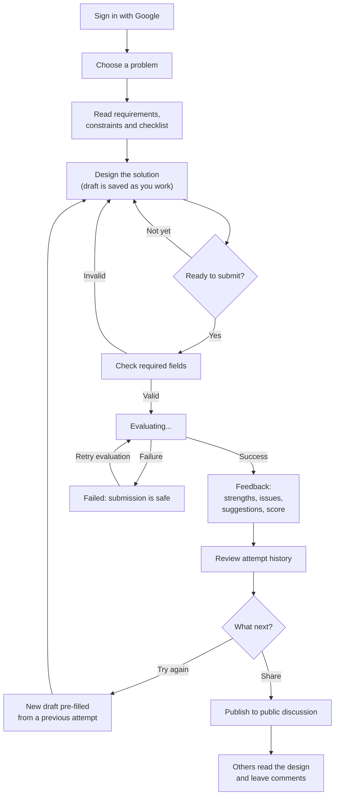
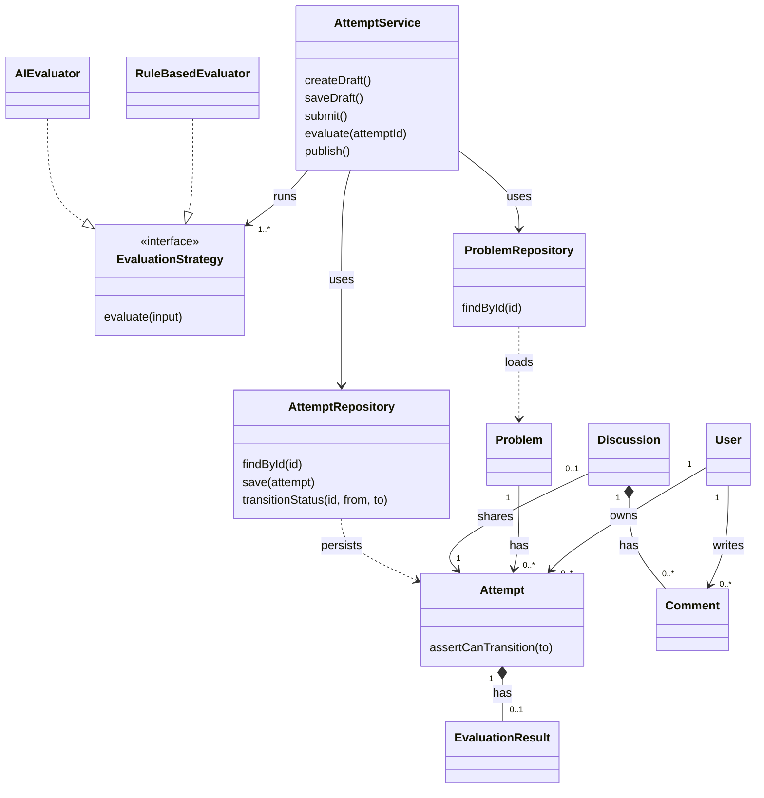
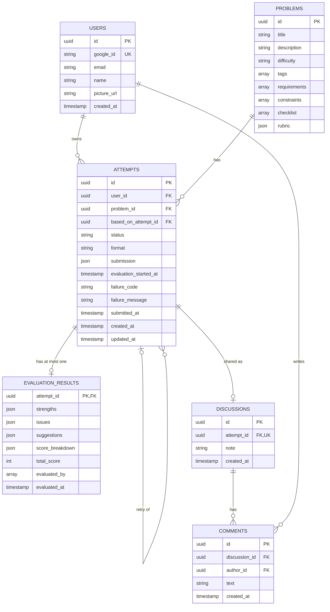

# LLD Practice Platform: Design Note
## 1. MVP Overview
**Problem.** People preparing for Low-Level Design interviews mostly read finished solutions. They get no feedback on their own design and can't see whether they improve.

**Users.** Learners (students, job seekers, junior engineers) practicing problems like "Design a Parking Lot".

**The MVP includes**
- Sign in with Google
- A few LLD problems with requirements, constraints, and a design checklist
- A structured submission form (classes, relationships, design notes)
- Evaluation after submission: automatic design checks plus an AI review
- Attempt history, with a retry that starts from an earlier attempt
- Sharing a finished attempt in a public discussion with comments

**Principles**
1. **Think first.** Learners design on their own before seeing any feedback. Problems store no reference solution, so nothing can leak.
2. **Explain, don't just grade.** Every criticism points to evidence in the learner's own submission.
3. **No single "correct" design.** Feedback is judged against the problem's requirements.

## 2. User Flow

- **Draft and submit.** The draft is saved as the learner works. Submitting locks it.
- **Evaluating** is a visible state. If it fails, the learner sees a Retry button and the submission is untouched.
- **Feedback** is private. History lets the learner open two attempts and compare them.
- **Sharing** is only possible for a completed attempt. The discussion shows the submission, not the feedback. Any signed-in user can comment.
- **AI is only used after submission.** Nothing in the design step is influenced by it.

## 3. Classes and Data Model
### Class diagram

`AuthService`, `DiscussionService`, `UserRepository`, and `DiscussionRepository` follow the same pattern as the classes shown and are left out to keep the diagram readable. Every entity above has a table in the database diagram below.

### What each class does
| Class | Job |
|---|---|
| `User`, `Problem`, `Attempt`, `EvaluationResult`, `Discussion`, `Comment` | Entities that hold data. `Attempt` also knows its legal status changes (`assertCanTransition`). |
| `EvaluationStrategy` (interface) | The contract for an evaluator: `evaluate(input)` turns a problem and a submission into feedback. |
| `RuleBasedEvaluator` | Runs fixed checks on the submission's structure (Section 4). |
| `AIEvaluator` | Builds the prompt, calls the LLM, and validates the reply. The only class that knows about the LLM. |
| `AttemptService` | Drafts, submit, publish, and the evaluation run: claim the attempt, run the evaluators, save the result, set the final status. |
| `AuthService`, `DiscussionService` | Google sign-in and session cookie. Discussions and comments. |
| Repositories | The only code that talks to PostgreSQL (through Prisma). No business rules. |

### Why it is built this way
- **The interface exists because there are two evaluators.** `AttemptService` runs them in order and doesn't care how each one works. Another evaluator is a new class that implements the interface.
- **Other submission formats are a later step.** `attempts.format` is always `structured-text` in the MVP, and every evaluator reads it. A new format (UML or code) would add a value there plus evaluators for it, and the service would then choose evaluators per format. That choice is not built now.
- **Repositories are separate.** The service never sees SQL, and the evaluators never see the database.
- **`Attempt` guards its own lifecycle.** The repository enforces the same rules atomically in the database.

### Database tables (PostgreSQL)

PK is a primary key, FK a foreign key, UK a unique column. All IDs are UUIDs.
- **`status`** is one of `DRAFT`, `SUBMITTED`, `EVALUATING`, `COMPLETED`, `FAILED`.
- **`submission`** is one JSON document: `classes` (name, kind, responsibilities, attributes, methods), `relationships` (from, to, type, note), and `designNotes`. It is always read and written whole, so it doesn't need its own tables. The backend validates its shape before every write.
- **`format`** is always `structured-text` in the MVP (see above).
- **Feedback** has its own table with one row per attempt. This keeps history lists light, and the primary key on `attempt_id` guarantees at most one result.
- **A discussion** points to its attempt (unique), so each attempt is shared at most once. Its problem and author are reached through the attempt, so nothing is stored twice. Comments are deleted with their discussion.

## 4. Evaluation
Evaluation has two parts with different jobs:

| | Rule-based evaluator | AI evaluator |
|---|---|---|
| Nature | Deterministic: same submission, same findings | Judgment: reasons about context |
| Good at | Facts about the submission's structure | Responsibilities, coupling, abstractions, trade-offs |
| Cost | Instant, no network | Seconds, and it can fail |

`AttemptService` runs the rule-based evaluator first and the AI evaluator second. The AI receives the rule findings as input, so it doesn't repeat them and can decide whether a heuristic matters for this problem. The feedback from both is merged and saved.

### Rule-based checks
The `RuleBasedEvaluator` holds a list of rules. Each rule is a small function: it reads the submission and returns zero or more findings. Rules only look at the **structure** of the submission (class names, kinds, methods, relationships). They know nothing about the problem, so they never claim a design is good or bad for it. That is the AI's job.

| Rule | Type | Flags | Severity |
|---|---|---|---|
| `UNDECLARED_CLASS` | Check | A relationship's `from` or `to` is not the name of any declared class | major |
| `DUPLICATE_CLASS` | Check | Two classes have the same name, ignoring case | major |
| `BAD_IMPLEMENTATION` | Check | An `implementation` relationship whose target is not declared as an `interface` | major |
| `ISOLATED_CLASS` | Heuristic | A class that appears in no relationship | optional |
| `UNUSED_INTERFACE` | Heuristic | An interface that no class implements | optional |
| `LARGE_CLASS` | Heuristic | A class with more than 8 methods | optional |

- **Checks are facts.** The submission contradicts itself, so they are reported as real issues.
- **Heuristics are signals.** They are always `optional`, are labeled "worth a look", and never count as definite flaws. An isolated class may be a perfectly good value object.
- **Thresholds** such as "8 methods" are constants in one file. Adding a rule means adding one function to the list.
- **Example.** The learner writes a relationship `Car → Vehicl` (a typo). `UNDECLARED_CLASS` reports: *"Relationship refers to undeclared class `Vehicl`"*, with the relationship as evidence.

### AI review
The prompt contains the problem's requirements, checklist, and rubric, the submission, and the rule findings. The model reviews responsibilities, coupling, abstractions, relationships, extensibility, patterns, and trade-offs against **this problem's requirements**.
- **More than one design can be valid.** The prompt says so, and every criticism must tie to a requirement or rubric item.
- **Evidence is required.** An issue without evidence is rejected by the backend.
- **Severity matters.** `major` is for requirement violations or serious coupling and responsibility problems. Everything else is `minor` or `optional`.
- **No reference solution.** Problems store none, and the prompt forbids writing a replacement design. Suggestions describe changes, not full class lists.
- **Structured output.** The LLM is asked for JSON in a fixed schema, and the backend validates it before saving.

### Feedback fields
| Field | Contents |
|---|---|
| `strengths` | What the design does well (title, detail) |
| `issues` | Severity (`major`, `minor`, `optional`), title, evidence, explanation, and source (`rule-based` or `ai`) |
| `suggestions` | Actionable improvements (title, detail) |
| `scoreBreakdown` | Optional. One entry per rubric criterion: criterion, score (0 to 5), comment. From the AI only |
| `totalScore` | The sum of the validated breakdown, computed by the backend. Empty when there is no valid breakdown |
| `evaluatedBy`, `evaluatedAt` | Which evaluators ran, and when |

### Scoring
- **Scale.** Every criterion is scored as an integer from 0 to 5 (0 not addressed, 1 to 2 weak, 3 adequate, 4 to 5 strong). The scale is the same for all problems.
- **Rubric.** Each problem lists its criteria (a name and a short description), usually 4 to 6. A problem without a rubric gets no score.
- **Validation.** The AI must return exactly one entry per rubric criterion, with matching names and integer scores from 0 to 5. The backend checks every entry.
- **Total.** The backend adds up the validated scores. The maximum is 5 times the number of criteria, shown as, for example, "11 / 20".
- **Missing or invalid score.** If the written feedback is valid but the breakdown is missing or fails validation, the feedback is still saved and the score is left empty. The UI then shows "Score not available". The same display applies when the problem has no rubric, except the score area is hidden entirely.
- **Limitation.** The score is an LLM judgment and can vary between runs, so the UI labels it "indicative". The written feedback is the main product.

## 5. API
**Authentication.** Google OAuth uses the authorization-code flow with PKCE, state, and nonce, started through `GET /api/auth/google`. Google redirects directly to the Node backend callback at `GET /api/auth/google/callback`, which exchanges the code, verifies the Google identity token, maps the Google subject to a local `User`, and issues a signed, HttpOnly session cookie. The backend exposes current-session and logout endpoints; Next.js server routes also verify the signed cookie for private product operations. Supabase Auth is not used; Supabase provides PostgreSQL only. Every authenticated API requires a valid app session (`401` otherwise) except public problem and discussion reads. An attempt can only be read or changed by its owner; anyone else gets `404`. There are no roles or admin actions. The browser starts sign-in against the backend origin on port 4000; see `README.md` for Google Cloud setup.|

## 8. Current implementation decisions

- Mutable workspace state is stored in a dedicated Draft table. Submitted Attempt rows are immutable snapshots used for history, evaluation, and community posts.
- A learner has one standard draft per problem and one retry draft per source attempt, so retries do not overwrite an existing workspace.
- Only COMPLETED attempts may be published. Published discussions render the saved submission snapshot, not a live draft.
- Gemini structured output is validated server-side. AI findings without an exact submission citation are discarded; deterministic findings remain visible.
